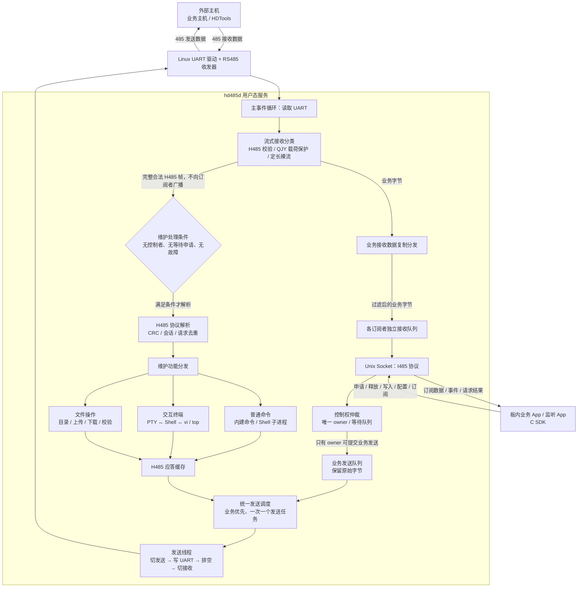
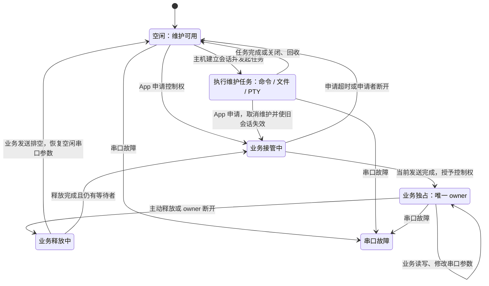
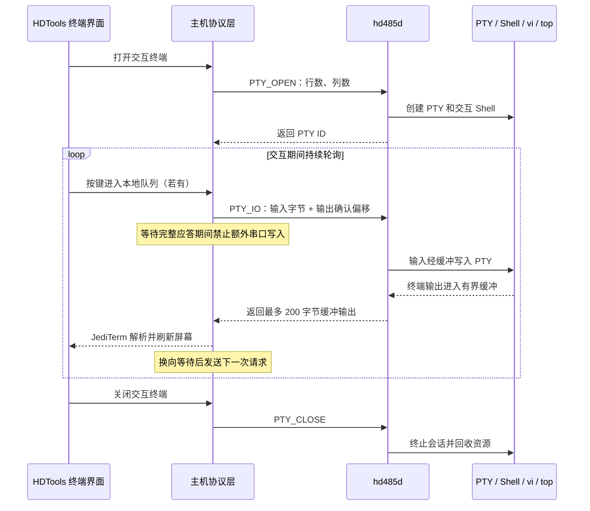

# hd485d 架构、状态与数据流

更新日期：2026-11-20。对应当前源码 **hd485d 0.4.1 / HDTools 0.2.0**。
以下以已选用的 **方式一 `--mode idle`** 为主，描述源码行为，不代表实时板端状态查询。
图表使用 Mermaid，可在支持 Mermaid 的 Markdown 阅读器中查看。

## 1. 总体结构

**hd485d 独占硬件串口；板内 App 通过 C SDK 共享串口；外部主机通过同一条 RS485
发送业务数据或维护协议。**

当前实现是用户态服务，底层使用 Linux 已有的 UART 驱动。C SDK 面向用户态 App，
目前没有提供内核驱动直接调用的接口。

图中的模块是逻辑职责，不是各自独立的线程。主事件循环负责 IPC、UART 接收、仲裁、
协议解析和维护任务推进；发送线程负责 UART 写入、排空及收发方向切换。
Shell、vi、top 则运行在独立子进程中。

### 接收路径

1. hd485d 从 UART 读取数据，先进入流式分类器。
2. 完整合法 H485 帧仅进入维护路径，不向业务订阅者广播；维护条件不满足时也不泄漏。
3. 普通业务字节和受保护的业务载荷复制到各订阅者队列，附带业务输出序号和 epoch。

控制者申请成功后自动订阅；只读订阅不影响控制权。业务接收片段仍不保证等于完整帧，
原业务解析器继续负责组帧。订阅接口不自动回送 hd485d 自身的 TX。
慢订阅者仍使用独立有界队列，丢失事件可观察。

RV1106 qjy 配置保护 AA 5A 帧的完整载荷；OTA 通过 owner 提前声明 N 字节原始段，
避免删除业务数据中恰好出现的 H485。错误/不完整维护候选不能保证属于维护，按原顺序
回送业务流，保持普通字节语义。详细规则见 PROTOCOL.md 的 0.4.0 小节。

### 发送路径

- 业务 App：SDK WRITE → owner 权限检查 → 业务发送队列 → 统一发送调度 → UART。
  业务字节不增加 H485 封装；WRITE 成功表示已入队，发送完成另由 TX_DONE 事件报告。
- 大帧（0.4.1）：SDK TX_BEGIN 声明整帧长度 → TX_DATA 每块 ≤8 KiB → 固定 32 KiB 环形缓冲 → 串口线程连续消费。满缓冲时延迟 DATA 应答，腾出空间后事件唤醒；整帧末尾只 drain/换向一次，BEGIN ticket 收到一个 TX_DONE。App 工作队列也用通知管道唤醒，避免定时 poll 引入额外等待。
- 维护应答：维护处理结果 → H485 封装及缓存 → 统一发送调度 → UART。
  应答有发送期限，过期不补发。
- 所有发送共用一个发送线程，一次处理一个任务。发送前切换 DE，写入后等待排空，
  再切回接收；GPIO/驱动后端按平台适配。

## 2. 方式一的控制状态

以下是逻辑状态图，不是 `status.mode` 字段的枚举。“空闲”指当前没有业务控制者或
正在执行的维护任务，不表示已经创建 Shell；PTY 只在收到打开请求后创建。

业务申请优先于维护。申请进入等待队列后，不再处理新的维护请求；当前已开始的串口
发送需要完成，再授予控制权。PTY 子进程异步清理，默认有 500 ms 退出宽限，随后强制回收。

多个申请者按等待顺序处理；不等待的申请在已有 owner 或等待者时返回 EBUSY。
只有 owner 能写串口、设置串口参数。修改参数要求没有在途发送或待发送业务数据。

主动释放或 owner 断开后，先完成已排队的业务发送，再恢复服务启动时的串口参数、
清除控制权及旧维护会话。存在等待者时继续交接；否则允许主机重新建立维护会话。
旧 PTY 不会恢复。只读订阅者始终不阻止维护。

串口故障也可能发生在交接阶段；图中仅画出主要入口。故障进入锁定状态，不能把恢复
线路连接等同于服务自动恢复，需排查并重新启动服务。

### status 字段

| 字段 | 含义 |
|---|---|
| `mode=0` | 配置为方式一 idle，不代表当前没有业务 |
| `mode=1` | 配置为方式二 coexist |
| `owner=0` | 没有 App 持有控制权 |
| `owner≠0` | 某个客户端持有控制权；该值不是进程 PID |
| `epoch` | 控制权或串口配置变化的代次 |
| `tx` | 尚在业务发送队列中的字节数，不包含已提交给发送线程的任务 |
| `error` | 串口故障状态，0 表示没有记录到故障 |
| `rx` | 业务接收输出块序号，不是累计接收字节数 |

## 3. PTY 交互的数据流

PTY 输出由主机轮询取回，板端不会主动向总线持续推送终端输出。

输入写入、程序执行、输出读取是异步推进的；某次 PTY_IO 的应答不保证包含本次输入
产生的输出，可能返回此前积压的数据或空数据，后续轮询继续取回。

- 板端输入队列 4 KiB、输出队列 64 KiB。输出满时施加背压，等待主机取走并确认。
- 单次 PTY_IO 输入和输出各最多 200 字节；偏移确认与请求去重避免正常重试导致重复执行。
- PTY 打开期间，普通命令和文件操作受到互斥限制；状态查询仍可用。
- 正常关闭发送 PTY_CLOSE。业务抢占使旧维护会话失效，并回收终端任务。
- 手动取消读取后，HDTools 停止后续自动发送，板端默认在 20 秒无有效 PTY 请求后回收。
  重新打开需要用户显式操作，不自动恢复旧会话。
- 终端内的 cwd、环境变量和别名在该 Shell 生命周期内保持；关闭后不回写普通命令会话目录。

## 4. 三类维护任务对比

| 功能 | 输入路径 | 输出路径 |
|---|---|---|
| 普通命令 | H485 EXEC → 命令处理器或 Shell | stdout/stderr 缓存 → 主机 POLL |
| 交互终端 | H485 PTY_IO → PTY → Shell/程序 | PTY 输出缓冲 → 后续 PTY_IO 应答 |
| 文件传输 | H485 文件请求 → 文件操作 | 数据块、偏移、校验结果 → H485 应答 |

板端的“业务控制权”和 HDTools 的“发送／读取／换向状态”是两个层次：前者决定谁能
控制串口，后者保证主机一次只进行一个请求—应答交互。HDTools 处于读取状态时仍可
将终端按键放入本地队列，但不能立即写入物理串口。

方式二 coexist 允许在业务 owner 存在时解析维护协议，但仍受业务优先、等待申请和
发送期限约束，需要外部主机安排通信时机。**当前 PTY 仅允许方式一**，启动参数会拒绝
`--allow-pty --mode coexist` 组合。上述状态图不适用于方式二。

## 5. 源码与相关文档

| 职责 | 源码入口 |
|---|---|
| 本地 SDK API | [include/hd485.h](include/hd485.h) |
| IPC 权限、申请与配置 | [src/daemon.c](src/daemon.c)，ipc_request |
| H485 请求与去重 | src/daemon.c，remote_request |
| UART 接收与分类 | src/daemon.c，uart_read；src/rx_filter.c，rx_filter_feed |
| 仲裁交接与发送调度 | src/daemon.c，progress |
| 发送线程、方向控制与排空 | [src/serial.c](src/serial.c)，worker |
| 维护任务分发 | [src/maintenance.c](src/maintenance.c)，maint_request |
| PTY 创建、缓冲与回收 | [src/pty_session.c](src/pty_session.c) |
| 文件系统扩展 | [src/filesystem.c](src/filesystem.c) |
| HDTools 请求及串口模式 | [Protocol.kt](HDTools/src/main/kotlin/com/hdtools/Protocol.kt) |
| HDTools 终端轮询与显示 | [PtyTerminal.kt](HDTools/src/main/kotlin/com/hdtools/PtyTerminal.kt) |

协议字段以 [PROTOCOL.md](PROTOCOL.md) 为准；板卡和资源测量见
[BOARD_PTY.md](BOARD_PTY.md)，部署启动与回退见 [DEPLOYMENT.md](DEPLOYMENT.md)，
验证记录见 [VALIDATION.md](VALIDATION.md)。

## 6. RV1106 业务 App 接入

APP 0.4.52 / UART 1.0.26 的 ttyS3 从机通过 hd485d SDK 接入；ttyS4 使用原串口后端。
正常状态只订阅；完整业务帧校验通过后取得控制权，再调用原处理器。同步应答等待
TX_DONE 后释放；广播在处理完成后释放；异步任务复制事务引用，最后一个引用结束才释放。
OTA 接收许可前声明原始段并持续持有控制权，结束/失败后清理。每个 SDK 句柄由专用
I/O 线程使用，业务线程通过任务队列和本地接收缓存与它交互。

断链会使在途事务失败并清空接收组帧状态；重连重新核验能力和订阅。连接代次禁止旧
异步回调向新连接发送结果，不重放未知是否执行的命令，不自动改为直开 ttyS3。
接入方式和实机记录见 [RV1106_INTEGRATION.md](RV1106_INTEGRATION.md)。
